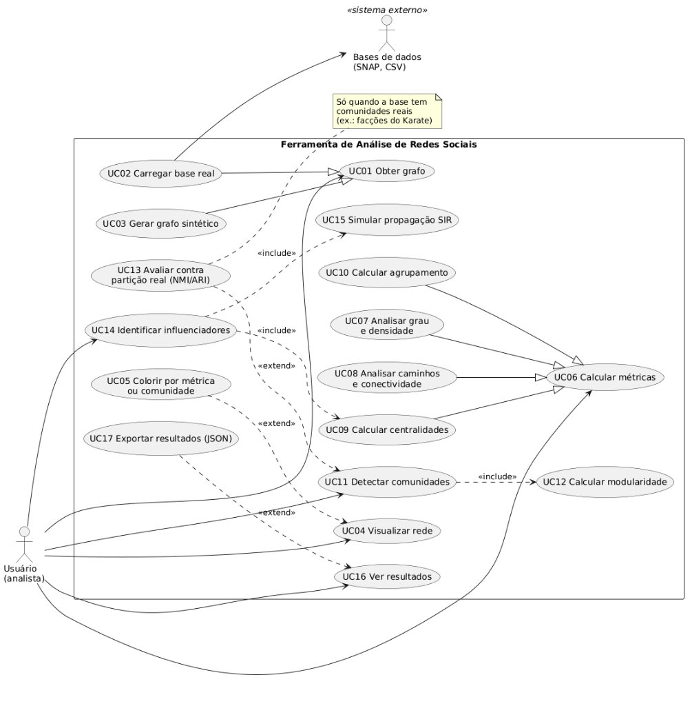

# Diagrama de Casos de Uso

Este documento descreve os casos de uso da ferramenta de análise de redes sociais: quem usa o
sistema, o que cada um pode fazer e como os casos de uso se relacionam. Ele faz parte da
modelagem UML avaliada na Etapa 1.

- Imagem: [`casos_de_uso.jpg`](casos_de_uso.jpg)
- Código-fonte do diagrama (PlantUML): [`casos_de_uso.puml`](casos_de_uso.puml)

## 1. Atores

| Ator | Tipo | Descrição |
| --- | --- | --- |
| **Usuário (analista)** | Primário | Usa a interface para carregar uma rede, calcular métricas, detectar comunidades, encontrar influenciadores e consultar os resultados. Na apresentação, é quem faz a demonstração. |
| **Bases de dados (SNAP, CSV)** | Secundário (sistema externo) | Arquivos públicos baixados das fontes oficiais: Twitch PT e ego-Facebook (SNAP), Network of Thrones (CSV) e Karate Club (já em `tests/dados/`). O sistema só lê esses arquivos. Veja [`dados/README.md`](../../dados/README.md). |

## 2. Lista de casos de uso

| ID | Caso de uso | Resumo | Frente | Módulo |
| --- | --- | --- | --- | --- |
| UC01 | Obter grafo | Caso de uso abstrato: deixar um grafo ativo na sessão | 1 | `redes/nucleo` |
| UC02 | Carregar base real | Ler uma base do SNAP ou um CSV e montar o `Grafo` | 1 | `redes/leitores` |
| UC03 | Gerar grafo sintético | Gerar um grafo Erdős–Rényi, Barabási–Albert ou Watts–Strogatz | 1 | `redes/geradores` |
| UC04 | Visualizar rede | Desenhar a rede com posições calculadas pelo Fruchterman–Reingold implementado pelo grupo | 6 | `redes/visualizacao`, `interface/` |
| UC05 | Colorir por métrica ou comunidade | Colorir ou dimensionar os nós por uma métrica ou pela comunidade | 6 | `interface/` |
| UC06 | Calcular métricas | Caso de uso abstrato que agrupa as análises estruturais | 2 a 4 | `redes/metricas` |
| UC07 | Analisar grau e densidade | Grau, distribuição de grau e densidade | 2 | `redes/metricas` |
| UC08 | Analisar caminhos e conectividade | BFS, DFS, componentes, Dijkstra, distância média e diâmetro | 2 | `redes/metricas` |
| UC09 | Calcular centralidades | Closeness, harmônica, betweenness, PageRank e k-core | 3 | `redes/metricas` |
| UC10 | Calcular agrupamento | Coeficiente de clustering e transitividade | 4 | `redes/metricas` |
| UC11 | Detectar comunidades | Louvain ou Label Propagation | 4 | `redes/comunidades` |
| UC12 | Calcular modularidade | Qualidade da partição encontrada | 4 | `redes/comunidades` |
| UC13 | Avaliar contra partição real | Comparar com as comunidades reais por NMI e ARI | 4 | `redes/comunidades` |
| UC14 | Identificar influenciadores | Problema aplicado: achar os nós que mais espalham informação | 5 | `redes/aplicacao` |
| UC15 | Simular propagação SIR | Simular o espalhamento a partir de cada nó candidato | 5 | `redes/aplicacao` |
| UC16 | Ver resultados | Consultar tabelas, rankings, gráficos e a rede com os resultados | 6 | `interface/` |
| UC17 | Exportar resultados (JSON) | Salvar o grafo e os resultados em JSON | 1 e 6 | `redes/leitores`, `interface/` |

## 3. Relacionamentos

- **Generalização**
  - *Carregar base real* (UC02) e *Gerar grafo sintético* (UC03) são as duas formas de *Obter grafo* (UC01).
  - *Analisar grau e densidade* (UC07), *Analisar caminhos e conectividade* (UC08), *Calcular centralidades* (UC09) e *Calcular agrupamento* (UC10) são tipos de *Calcular métricas* (UC06). Cada filho corresponde a uma frente do grupo.
- **«include»** (acontece sempre)
  - *Detectar comunidades* (UC11) sempre calcula a modularidade (UC12).
  - *Identificar influenciadores* (UC14) sempre usa as centralidades (UC09) e a simulação SIR (UC15).
- **«extend»** (acontece só às vezes)
  - *Colorir por métrica ou comunidade* (UC05) estende *Visualizar rede* (UC04), quando o usuário pede.
  - *Avaliar contra partição real* (UC13) estende *Detectar comunidades* (UC11), só quando a base tem comunidades reais (ex.: as facções do Karate Club).
  - *Exportar resultados* (UC17) estende *Ver resultados* (UC16), quando o usuário pede.
- **Pré-condição comum:** todos os casos de uso, menos o UC01 e seus filhos, exigem um grafo
  ativo. Isso aparece como pré-condição em cada descrição, e não como «include» de *Obter grafo*.

## 4. Descrição dos casos de uso

### UC01, UC02 e UC03: Obter grafo

| Campo | Descrição |
| --- | --- |
| Atores | Usuário; Bases de dados (no UC02) |
| Pré-condição | No UC02, o arquivo da base está em `dados/brutos/` (o Karate Club já está em `tests/dados/`). |
| Fluxo principal (UC02) | 1. O usuário escolhe a base (Karate Club, Twitch PT, ego-Facebook ou Network of Thrones). 2. O sistema lê o arquivo (lista de arestas `.txt` ou `.txt.gz`, ou CSV), ignorando comentários e laços. 3. O sistema reindexa os IDs dos nós e monta o `Grafo`, direcionado ou não, com ou sem peso. 4. O sistema mostra o número de nós e de arestas, para conferir com a tabela de `dados/README.md`. |
| Fluxo alternativo (UC03) | 1a. O usuário escolhe um modelo (Erdős–Rényi, Barabási–Albert ou Watts–Strogatz), informa os parâmetros (n, p, m, k, β) e a `seed`. 2a. O sistema gera o grafo e segue do passo 4. |
| Exceções | O arquivo não existe ou está em formato inválido: o sistema mostra uma mensagem de erro e mantém o grafo que estava ativo. |
| Pós-condição | Há um grafo ativo na sessão. |

### UC04 e UC05: Visualizar rede

| Campo | Descrição |
| --- | --- |
| Ator | Usuário |
| Pré-condição | Há um grafo ativo. |
| Fluxo principal | 1. O usuário abre a tela da rede. 2. O sistema calcula as posições dos nós com o Fruchterman–Reingold implementado pelo grupo. 3. O sistema desenha a rede com Plotly, com zoom e informações do nó ao passar o mouse. |
| Extensão (UC05) | O usuário escolhe colorir ou dimensionar os nós por uma métrica (grau, PageRank etc.) ou pela comunidade detectada. |
| Exceções | A rede é grande demais para desenhar com fluidez: o sistema avisa e desenha uma amostra ou só a maior componente. |
| Pós-condição | A rede aparece na tela. |

### UC06 a UC10: Calcular métricas

| Campo | Descrição |
| --- | --- |
| Ator | Usuário |
| Pré-condição | Há um grafo ativo. |
| Fluxo principal | 1. O usuário escolhe a métrica e os parâmetros (nó de origem, número de fontes da amostragem, fator de amortecimento do PageRank etc.). 2. O sistema calcula a métrica. 3. O sistema mostra o resultado (UC16) e o tempo gasto. |
| Fluxo alternativo | A métrica só faz sentido em grafo conexo (distância média, diâmetro): o sistema calcula na maior componente conexa e avisa o usuário. |
| Pós-condição | Os valores ficam disponíveis para a visualização (UC05) e a exportação (UC17). |

O que cada especialização entrega:

| Caso de uso | Resultado para o usuário |
| --- | --- |
| UC07 Analisar grau e densidade | Grau de cada nó, histograma da distribuição de grau e densidade |
| UC08 Analisar caminhos e conectividade | BFS e DFS a partir de um nó, componentes conexas e fortemente conexas, caminho mínimo por Dijkstra, distância média e diâmetro |
| UC09 Calcular centralidades | Closeness, harmônica, betweenness de Brandes (exata ou por amostragem de k fontes), PageRank e k-core |
| UC10 Calcular agrupamento | Clustering de cada nó, clustering médio e transitividade (contagem de triângulos) |

### UC11, UC12 e UC13: Detectar comunidades

| Campo | Descrição |
| --- | --- |
| Ator | Usuário |
| Pré-condição | Há um grafo ativo. |
| Fluxo principal | 1. O usuário escolhe o algoritmo (Louvain ou Label Propagation) e a `seed`. 2. O sistema detecta as comunidades. 3. O sistema calcula a modularidade da partição (UC12). 4. O sistema mostra o número de comunidades, o tamanho de cada uma e a modularidade. |
| Extensão (UC13) | Se a base tiver comunidades reais (ex.: as duas facções do Karate Club), o sistema compara a partição encontrada com elas por NMI e ARI. |
| Pós-condição | A partição fica disponível para colorir a rede (UC05) e para a exportação (UC17). |

### UC14 e UC15: Identificar influenciadores

| Campo | Descrição |
| --- | --- |
| Ator | Usuário |
| Pré-condição | Há um grafo ativo (base principal: Twitch PT). |
| Fluxo principal | 1. O usuário informa os parâmetros da simulação: taxa de infecção (β), taxa de recuperação (γ), número de execuções e `seed`. 2. O sistema calcula as centralidades dos nós (UC09). 3. Para cada nó candidato, o sistema simula o modelo SIR a partir dele e mede o alcance médio (UC15). 4. O sistema compara o ranking de cada centralidade com o alcance simulado, por correlação. 5. O sistema mostra os k maiores influenciadores e qual centralidade melhor prevê o espalhamento. |
| Fluxo alternativo | Rede grande: o sistema simula só os N primeiros nós de cada centralidade, para o tempo de execução ficar aceitável. |
| Pós-condição | O ranking de influenciadores fica disponível para a visualização e a exportação. |

### UC16 e UC17: Ver e exportar resultados

| Campo | Descrição |
| --- | --- |
| Ator | Usuário |
| Pré-condição | Há um grafo ativo e pelo menos uma análise feita. |
| Fluxo principal | 1. O usuário abre a tela de resultados. 2. O sistema mostra tabelas, rankings, histogramas e a rede com os resultados da sessão. |
| Extensão (UC17) | O usuário pede a exportação, e o sistema salva o grafo e os resultados em JSON. |
| Pós-condição | No UC17, o arquivo JSON é gerado. |

## 5. Como regerar a imagem

A imagem foi gerada a partir de [`casos_de_uso.puml`](casos_de_uso.puml). Depois de mudar o
arquivo `.puml`, gere a imagem de novo com a extensão PlantUML do VS Code, com o
[servidor online do PlantUML](https://www.plantuml.com/plantuml) ou com
`java -jar plantuml.jar documentos/uml/casos_de_uso.puml`, e substitua `casos_de_uso.jpg`.
